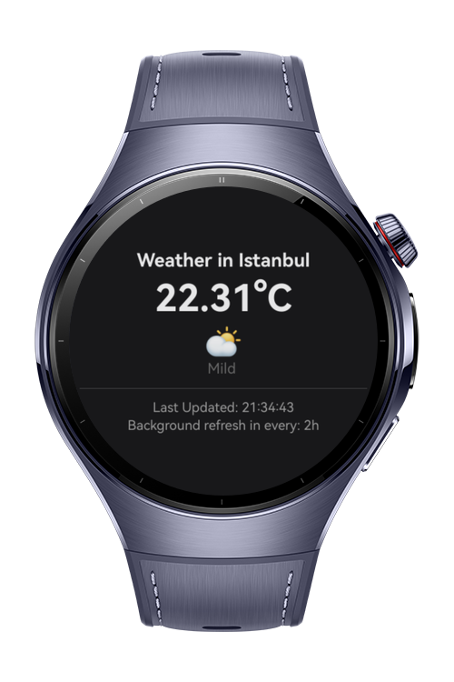

> **Note:** To access all shared projects, get information about environment setup, and view other guides, please visit [Explore-In-HMOS-Wearable Index](https://github.com/Explore-In-HMOS-Wearable/hmos-index).

# How to Build Background Task Scheduler

A battery-efficient background weather worker for HarmonyOS Next smart wearables. The app demonstrates how to use `WorkSchedulerExtensionContext` to register periodic background work that fetches weather data, saves it to local preferences, and displays it on the watch face. The codelab teaches how to keep a watch alive and useful between user interactions without draining the battery.

# Preview

<div>
  
</div>

# Use Cases

- **Background Data Sync**: Demonstrates how to periodically fetch weather data in the background using `WorkSchedulerExtensionAbility` without keeping the app foreground.
- **Battery-Efficient Scheduling**: Shows how to schedule recurring work at 2-hour intervals to minimize battery impact while keeping weather data fresh.
- **Local Data Persistence**: Illustrates using `@kit.ArkData` preferences to store and retrieve fetched data for display when the user opens the app.

**Target APIs**

| Module | Method | Role |
|---|---|---|
| WorkSchedulerExtensionAbility | `onWorkStart` | Entry point for background work execution |
| WorkSchedulerExtensionAbility | `onWorkStop` | Cleanup when background work is stopped |
| workScheduler | `WorkInfo` | Defines work parameters (, repeat count) |
| http | `createHttp` / `request` | Fetches weather data from OpenWeatherMap API |
| preferences | `getPreferences` / `put` / `get` | Stores and retrieves temperature and timestamp data |

# Technology

## Stack
- **Languages**: ArkTS, ArkUI
- **Frameworks**: HarmonyOS SDK 6.0.1(21)
- **Tools**: DevEco Studio Version 6.0.1.251
- **Libraries & Kits**:
  - `@kit.BackgroundTasksKit` — WorkSchedulerExtensionAbility, workScheduler
  - `@kit.NetworkKit` — HTTP requests for weather API
  - `@kit.ArkData` — Preferences for local data persistence
  - `@kit.PerformanceAnalysisKit` — hilog for logging

## Required Permissions
- ohos.permission.INTERNET
- ohos.permission.GET_NETWORK_INFO
- ohos.permission.KEEP_BACKGROUND_RUNNING

# Directory Structure
```
entry/src/main/ets/
├── entryability/
│   └── EntryAbility.ets            // Main entry point, schedules background work
├── workers/
│   └── WeatherWorker.ets           // WorkSchedulerExtensionAbility implementation
├── pages/
│   └── Index.ets                   // Main UI page displaying weather data
└── models/
    └── WeatherModel.ets            // Weather data response model
```
# Constraints and Restrictions

## Supported Device
- Huawei Watch 5
## Requirements
- OpenWeatherMap API key (free tier available)
- Network connectivity on the wearable device
- HarmonyOS API level 20 or higher
# License
How to Build Background Task Scheduler for HarmonyOS is distributed under the terms of the [LICENSE](./LICENSE).
